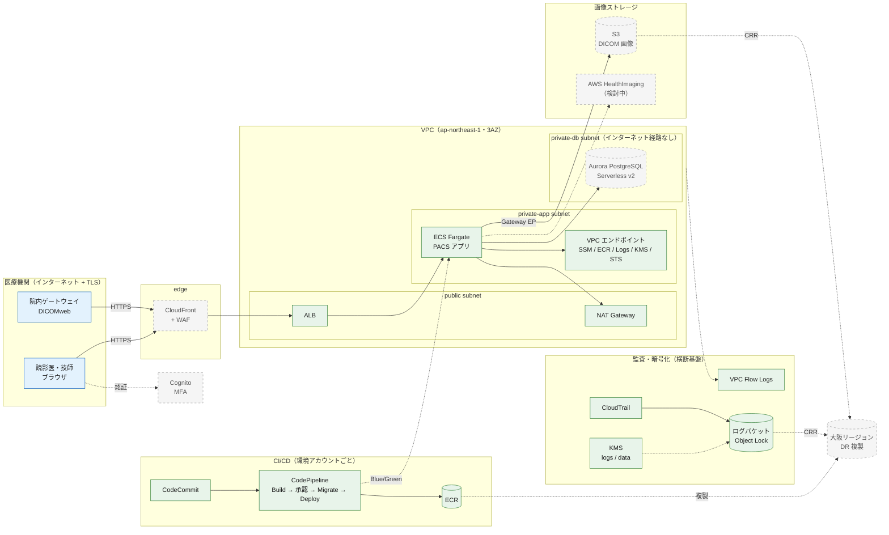

# PACS SaaS インフラ（Terraform）

3省2ガイドラインへの準拠を前提とした、医用画像システム（PACS）SaaS 向けの AWS インフラ。
要件と未決事項は [docs/requirements.md](../docs/requirements.md) を参照。

## ディレクトリ構成

```
infra/
├── cicd-templates/              # アプリリポジトリにコピーする buildspec・taskdef（Terraform モジュールではない）
└── terraform/
    ├── environments/
    │   ├── _shared/                 # 全環境共通のルートモジュール実体（編集すると3環境すべてに反映）
    │   │   ├── versions.tf          # backend "s3" {}（値は backend.hcl で指定）
    │   │   ├── providers.tf
    │   │   ├── variables.tf
    │   │   ├── main.tf
    │   │   └── outputs.tf
    │   └── dev/ stg/ prod/          # *.tf は _shared へのシンボリックリンク
    │       ├── terraform.tfvars     # 環境差分（実体）
    │       └── backend.hcl.example  # backend.hcl にコピーして使用
    └── modules/
        ├── security/
        │   └── kms/                 # 用途別 CMK（logs / data）。DR 有効時は DR リージョンにも作成
        ├── logging/
        │   └── cloudtrail/          # 証跡 + Object Lock 付きログバケット（DR 時は大阪へ CRR）
        ├── network/
        │   ├── vpc/                 # 3層サブネット・NAT・Flow Logs
        │   └── vpc-endpoints/       # Gateway / Interface エンドポイント
        ├── compute/
        │   ├── ecr/                 # イメージリポジトリ（タグ不変・スキャン。DR 時は大阪へ複製）
        │   ├── alb/                 # ALB・Blue/Green 用ターゲットグループ・テストリスナー
        │   ├── ecs/                 # クラスター・サービス（ネイティブ Blue/Green）
        │   └── ecs-scheduled-stop/  # 夜間・土日のタスク停止（Application Auto Scaling のスケジュールアクション）
        └── cicd/
            └── pipeline/            # CodeCommit・CodeBuild・CodePipeline（本番承認付き）
```

## アーキテクチャ

基本構成は次のとおり（緑：実装済み、灰色の破線：未実装・検討中、青：医療機関側）。



| コンポーネント | モジュール | 状態 |
|---|---|---|
| KMS（logs / data） | `security/kms` | 実装済み |
| CloudTrail | `logging/cloudtrail` | 実装済み |
| VPC・Flow Logs | `network/vpc` | 実装済み |
| VPC エンドポイント | `network/vpc-endpoints` | 実装済み |
| Cognito（MFA） | `security/cognito` | 未実装 |
| CloudFront・WAF | `edge` | 未実装 |
| ECR | `compute/ecr` | 実装済み |
| ALB | `compute/alb` | 実装済み |
| ECS（ネイティブ Blue/Green） | `compute/ecs` | 実装済み |
| ECS 夜間・土日停止 | `compute/ecs-scheduled-stop` | 実装済み |
| CI/CD（CodePipeline） | `cicd/pipeline` | 実装済み |
| Aurora PostgreSQL | `database/aurora-postgresql` | 未実装 |
| DR 複製（CloudTrail ログ・ECR → 大阪） | `logging/cloudtrail`・`compute/ecr` | 実装済み（`dr_enabled`） |
| 画像ストレージ（S3 Lifecycle・大阪 DR 複製） | `storage` | 未実装 |
| AWS Backup（Vault Lock） | `backup` | 未実装 |
| 監視・通知 | `monitoring` | 未実装 |
| コスト監視 | `governance` | 未実装 |

## 環境スイッチ

環境ごとの差分は各環境の `terraform.tfvars` の先頭にある「環境スイッチ」「ログ保持期間」で切り替える。`environments/_shared/` は編集しない。

| 変数 | 内容 | dev | stg | prod | 切り替え時の影響 |
|---|---|---|---|---|---|
| `network_ha_enabled` | NAT Gateway・Interface エンドポイントを AZ ごとに置く | false | true | true | NAT Gateway の増減とルートの張り替えにより、数分間外向き通信が途切れる |
| `ecs_scheduled_stop_enabled` | 平日 21:00〜8:00 と土日にタスク数を 0 にする（時刻は `ecs_stop_schedule` / `ecs_start_schedule`） | true | true | false | 祝日は対象外。停止中に apply するとタスクが起動する |
| `ecs_autoscaling_enabled` | CPU 使用率（`ecs_autoscaling_cpu_target`）に応じて `app_desired_count`〜`app_max_count` の範囲でタスク数を増減する | false | false | true | 無効時は `app_desired_count` で固定 |
| `ecs_container_insights` | Container Insights（`enabled` / `enhanced` / `disabled`） | disabled | enabled | enabled | クラスターの設定変更のみ（再作成なし） |
| `ecs_exec_enabled` | ECS Exec（コンテナへの対話ログイン）。セッションは KMS で暗号化し、操作内容を CloudWatch Logs に記録する | true | false | false（固定） | prod は true にできない。次のデプロイで起動したタスクから有効 |
| `s3_object_lock_enabled` | ログバケットの Object Lock（改ざん防止） | true | true | true（固定） | prod は false にできない。ON → OFF にしてもロック済みのログは保護されたまま |
| `dr_enabled` | 大阪リージョン（`dr_region`）への複製（CloudTrail ログの CRR・ECR イメージ） | false | false | false（RTO/RPO 確定後に true） | 有効化以降のデータだけが複製される。下記の注意を参照 |

ログ保持期間は `app_log_retention_days`・`build_log_retention_days`・`flow_logs_retention_days`・`cloudtrail_cloudwatch_retention_days`（CloudWatch Logs。CloudWatch が受け付ける日数のみ指定可）と、`cloudtrail_object_lock_days`・`cloudtrail_glacier_transition_days`・`cloudtrail_log_retention_days`・`alb_access_log_retention_days`・`pipeline_artifact_retention_days`（S3）で設定する。ECR に残すイメージ世代数は `ecr_max_image_count` で設定する。

### DR の注意

- `dr_region` は国内リージョンかつ `region` と別のリージョンに限る（validation）
- 既存のログは複製されない。必要な場合は S3 Batch Replication で複製する
- レプリカバケットにも複製元と同じ Object Lock がかかり、`prevent_destroy` を設定している。`dr_enabled` を false に戻す場合は、レプリカバケットを `terraform state rm` で管理対象から外してから apply する（バケットとログは残る）
- 画像（`storage`）と AWS Backup（`backup`）の複製は、各モジュールの実装時に同じ `dr_enabled` につなぐ

## 運用手順

### 初回セットアップ（環境ごと）

1. tfstate 用 S3 バケットを対象アカウントに用意する（バージョニング・KMS 暗号化・パブリックアクセスブロックを有効化）
2. `terraform.tfvars` の TODO（`aws_account_id`・`acm_certificate_arn`・`alb_test_listener_cidrs`）を実際の値に置き換える
3. backend を設定して初期化する

```sh
cd infra/terraform/environments/dev
cp backend.hcl.example backend.hcl   # 値を埋める
terraform init -backend-config=backend.hcl
terraform plan
```

### アプリのデプロイ

1. [infra/cicd-templates/](./cicd-templates/README.md) の buildspec・taskdef をアプリリポジトリのルートにコピーする
2. `terraform output codecommit_clone_url_grc` のリポジトリへ `main` ブランチを push すると、パイプラインが起動する
3. dev → stg → prod の昇格は、検証済みのコミットを次の環境のリポジトリへ push して行う
4. prod は Approval ステージで停止する。変更作成者以外の承認者（`pipeline_approver_policy_json` を付与した権限セット）が承認すると、Migrate → Deploy に進む

### 注意事項

- **prod の CloudTrail バケットは Object Lock の COMPLIANCE モード**のため、保持期間中はログを削除できず、期間の短縮もできない。初回 apply の前に保持日数を確定させること
- ログバケットには `prevent_destroy` を設定している
- 管理者のアクセスは IAM Identity Center（MFA 必須）で行い、サーバーへのログインは SSM Session Manager を使う（SSH・公開 IP は使わない）
